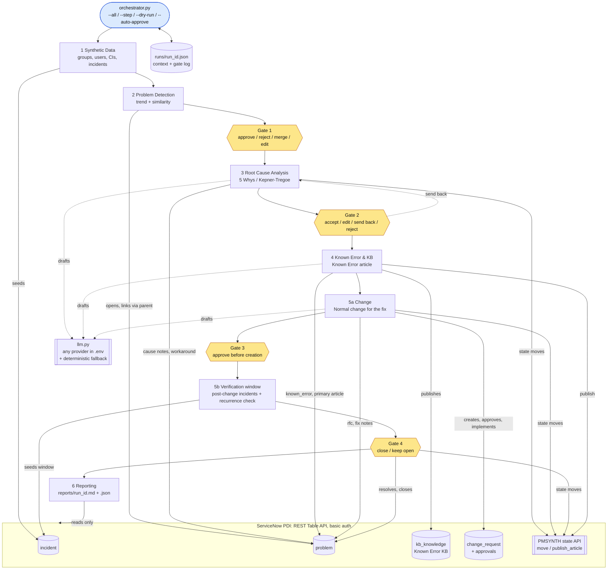

# Architecture

## Agents, data flow and human gates

Every agent is one module with `run(context) -> result` and a `check(context)` that rereads the PDI.
The orchestrator passes the run context (`runs/<run_id>.json`) from step to step, saves it after each
step and stops at the first failed check. Every gate decision is logged twice: in the context (who,
when, what changed) and as a work note on the ServiceNow record.

## The agents

**0. Orchestrator** (`orchestrator.py`). Runs the steps in order or one at a time, passes `--dry-run`
(no writes anywhere) and `--auto-approve` (rehearsal: each gate answered with its recommendation), and
runs each step's success check after a live step.

**1. Synthetic Data** (`synthetic_data_agent.py`). Seeds tagged groups, users, CIs and 200 incidents over
60 days: four planted recurring problems with a known mechanism (database logs filling a disk, a weekly
certificate job that does not restart a proxy, a VPN firmware bug, a month-end batch locking a
database), one decoy burst with unrelated causes, and noise. Clues sit in the work notes, the CI details
and the timing, as they would in real tickets. It writes the answer key that only evaluation reads. In
phase 6 it also seeds the post-change window: noise, plus any planted pattern whose fix was not
implemented.

**2. Problem Detection** (`detection_agent.py`). Groups incidents by CI and by business service, keeps
the dominant category, refines each group by TF-IDF cosine similarity of short descriptions (centroid by
default; agglomerative and DBSCAN optional), and flags groups with at least 5 incidents in 14 days. It
scores frequency, impact and affected users into a proposed impact/urgency, assigns a confidence, and at
Gate 1 opens approved candidates as problems and links their incidents.

**3. Root Cause Analysis** (`rca_agent.py`). Collects evidence from the PDI: linked incidents and their
work notes, CI attributes (firmware, OS), comparable CIs of the same class, changes on the CI, weekday
and month-end patterns, close codes. Uses 5 Whys, or a Kepner-Tregoe "is / is not" table when the
evidence spans several CIs or subcategories or has no dominant clue. The LLM writes the analysis from
the evidence only; a rule-based engine does it without an LLM. Cited incidents are checked to really be
linked. Gate 2 accepts, edits, sends back or rejects.

**4. Known Error & KB** (`knowledge_agent.py`). For each accepted RCA, writes a Known Error article
(description, cause, workaround) that only restates what was accepted at Gate 2, publishes it, marks the
problem a known error with that primary article, and posts the workaround on the problem's open incidents.

**5. Change & Closure** (`change_agent.py`). Drafts a Normal change for the permanent fix: description,
justification, risk, implementation, backout and test plans. Gate 3 approves it before it exists. The
agent creates it, links it (`rfc`, fix notes, Fix in Progress), records the Gate 3 decision on the
platform's assignment-group and CAB approvals, and simulates implementation to Closed / Successful.
`--close` then has the Synthetic Data Agent seed a verification window, checks each problem for
recurrence (same CI or service, main subcategory, similar text), and Gate 4 resolves and closes the
problem with Fix Applied, or keeps it open.

**6. Reporting** (`reporting_agent.py`). Produces `reports/<run_id>.md` (summary, detected vs planted,
RCA accuracy, incidents per problem with a Mermaid chart, known errors, changes, time in each state,
estimated incidents prevented, gate decisions) and the same numbers as JSON. It reads only the PDI (and
the answer key for scoring); its check recomputes every number and adds independent direct counts.

**Shared pieces.** `sn_client.py` (REST client: basic auth from `.env`, max 3 retries with backoff,
polite rate limit, dry run, hibernation detection), `config.py` (tag, run context, thresholds, choice
lookup from `config/instance.json`), `llm.py` (one wrapper for anthropic, openai, gemini, xai, ollama or
any OpenAI-compatible server), `state_api.py` (server-side state moves and publishing, where the Table
API ignores the field), `verify_instance.py`, `setup_integration_user.py`, `reset.py`.

## Mapping to ITIL 4 Problem Management

ITIL 4 describes three phases: **problem identification**, **problem control** and **error control**.

| ITIL 4 activity | Where it happens |
|---|---|
| **Problem identification**: trend analysis of incident records; detecting duplicate and recurring issues | Detection Agent (proactive trending over 60 days and reactive grouping by CI/service); Gate 1 decides which candidates become problems; priority from impact and urgency |
| **Problem control**: problem analysis; documenting workarounds and known errors | RCA Agent (5 Whys, Kepner-Tregoe, evidence from incidents, CIs and timing; workaround); Gate 2; Known Error & KB Agent (known error record, published Known Error article, workaround to open incidents) |
| **Error control**: managing known errors; identifying a permanent solution; change requests; reassessing effectiveness | Change & Closure Agent: Normal change for the fix with risk and backout (Gate 3, then change enablement's approvals), implementation, verification window to reassess whether the error is really gone, closure with a resolution code (Gate 4) or keeping it open when it recurs |
| **Continual improvement / measurement** (supports all three) | Reporting Agent: detection accuracy, RCA accuracy, known errors, changes, time in state, incidents prevented; every number recomputed from the PDI |

Human gates sit where ITIL 4 expects judgement: deciding that something is a problem, accepting a cause,
authorising a change, and confirming that a fix worked before closing.

## Safety rules built into the design

- Only records this project created are modified; every record is tagged and `reset.py` deletes only
  tagged records (dry run by default) and checks untagged counts are unchanged.
- Agents run as the web-service-only integration user; admin is used only for setup, seeding, reset,
  metadata reads and the documented exceptions (closed-incident links, approvals).
- Secrets live in `.env` (gitignored) and are never printed, logged or sent in queries.
- Every agent has `--dry-run`; every gate has a deterministic fallback when no LLM is available.
