# Problem Management run report — 20261029-192408

Run tag `PMSYNTH-20261029-192408` · generated 2026-11-10 19:36 UTC · every number below is recomputed from the PDI (`python reporting_agent.py --check 20261029-192408`).

## Summary

- Planted problems detected: **4 of 4**; decoy raised as a problem: **no**; unplanted problems opened: 2 (PRB0040010, PRB0040011)
- Root causes matching the answer key: **4 of 4** (known error articles: 4 of 4)
- Known errors: **6**, articles published 6 of 6
- Changes raised: **6** (Normal 6, closed Successful 6)
- Problems closed: **4** (Fix Applied 4), kept open: 2
- Estimated recurring incidents prevented: **30.8** (closed problems, verification window; see below)
- Incidents in the run: 253

## Detected vs planted

| Pattern | CI | Planted incidents | Problem | Recall | Precision |
|---|---|---|---|---|---|
| a | db-prod-01 | 16 | PRB0040008 | 100% | 100% |
| b | mail-01 | 23 | PRB0040006 | 100% | 88% |
| c | vpn-gw-01 | 15 | PRB0040009 | 100% | 100% |
| d | payroll-app-01 | 14 | PRB0040007 | 100% | 100% |
| e (decoy) | sp-web-01 | 7 | not raised | - | - |

## Problems

| Problem | Pattern | Linked incidents | State | RCA vs key | Known error | Change | Resolution |
|---|---|---|---|---|---|---|---|
| PRB0040006 | b | 26 | Closed | match | KB0010003 (published) | CHG0030003 (Closed, successful) | fix_applied |
| PRB0040007 | d | 14 | Closed | match | KB0010004 (published) | CHG0030004 (Closed, successful) | fix_applied |
| PRB0040008 | a | 16 | Closed | match | KB0010005 (published) | CHG0030005 (Closed, successful) | fix_applied |
| PRB0040009 | c | 15 | Closed | match | KB0010006 (published) | CHG0030006 (Closed, successful) | fix_applied |
| PRB0040010 | unplanted | 14 | Fix in Progress | not scored | KB0010007 (published) | CHG0030007 (Closed, successful) | - |
| PRB0040011 | unplanted | 9 | Fix in Progress | not scored | KB0010008 (published) | CHG0030008 (Closed, successful) | - |

## Incidents before and after the change

Linked incidents before the change vs similar incidents in the post-change verification window (simulated dates after the changes).

```mermaid
xychart-beta
    title "Incidents per problem: before vs after the change"
    x-axis ["PRB0040006", "PRB0040007", "PRB0040008", "PRB0040009", "PRB0040010", "PRB0040011"]
    y-axis "Incidents"
    bar [26, 14, 16, 15, 14, 9]
    bar [0, 0, 0, 0, 6, 2]
```

First bar: linked incidents before the change. Second bar: similar incidents in the window.

## Estimated recurring incidents prevented

Estimate = incident rate before the change (linked incidents ÷ 59.2 days of data before the changes) × window days − similar incidents seen in the window. It assumes the pattern would have continued at its average rate; it is an estimate, not a measurement.

| Problem | Window | Rate before (/day) | Expected without fix | Similar in window | Prevented (est.) |
|---|---|---|---|---|---|
| PRB0040006 | 2026-11-05 to 2026-12-01 | 0.439 | 11.3 | 0 | 11.3 |
| PRB0040007 | 2026-11-05 to 2026-12-01 | 0.237 | 6.1 | 0 | 6.1 |
| PRB0040008 | 2026-11-05 to 2026-12-01 | 0.27 | 6.9 | 0 | 6.9 |
| PRB0040009 | 2026-11-05 to 2026-12-01 | 0.254 | 6.5 | 0 | 6.5 |
| PRB0040010 (kept open) | 2026-11-05 to 2026-12-01 | 0.237 | 6.1 | 6 | not counted |
| PRB0040011 (kept open) | 2026-11-05 to 2026-12-01 | 0.152 | 3.9 | 2 | not counted |

## Time in each problem state (hours)

From the audit history of `problem.state`. These reflect the pace of this project's build and gate runs, not real operations. Time in Closed is not counted (it ends the lifecycle).

| Problem | New | Assess | Root Cause Analysis | Fix in Progress | Resolved | Closed |
|---|---|---|---|---|---|---|
| PRB0040006 | 167.0 | 0.3 | 1.6 | 103.0 | 0.0 | - |
| PRB0040007 | 167.5 | 0.0 | 1.6 | 103.2 | 0.0 | - |
| PRB0040008 | 167.5 | 0.0 | 1.6 | 102.8 | 0.0 | - |
| PRB0040009 | 167.6 | 0.0 | 1.6 | 102.8 | 0.0 | - |
| PRB0040010 | 167.7 | 0.0 | 1.5 | 118.5 | - | - |
| PRB0040011 | 168.1 | 0.0 | 1.2 | 118.5 | - | - |
| **median** | 167.6 | 0.0 | 1.6 | 103.1 | 0.0 | - |

## Human gate decisions (from the problems' work notes)

- **PRB0040006**: Gate 1: approved by brinleyeverson; Gate 2: accept by brinleyeverson; Gate 2: accept by brinleyeverson; Gate 3: change CHG0030003 approved by brinleyeverson; Gate 4: close by brinleyeverson
- **PRB0040007**: Gate 1: approved by brinleyeverson; Gate 2: accept by brinleyeverson; Gate 3: change CHG0030004 approved by brinleyeverson; Gate 4: keep open by brinleyeverson; Gate 4: close by brinleyeverson
- **PRB0040008**: Gate 1: approved by brinleyeverson; Gate 2: accept by brinleyeverson; Gate 3: change CHG0030005 approved by brinleyeverson; Gate 4: close by brinleyeverson
- **PRB0040009**: Gate 1: approved by brinleyeverson; Gate 2: accept by brinleyeverson; Gate 3: change CHG0030006 approved by brinleyeverson; Gate 4: close by brinleyeverson
- **PRB0040010**: Gate 1: approved by brinleyeverson; Gate 2: accept by brinleyeverson; Gate 2 (revised): sent back by brinleyeverson; Gate 2: accept by brinleyeverson; Gate 3: change CHG0030007 approved by brinleyeverson; Gate 4: keep open by brinleyeverson
- **PRB0040011**: Gate 1: approved by brinleyeverson; Gate 2: accept by brinleyeverson; Gate 3: change CHG0030008 approved by brinleyeverson; Gate 4: keep open by brinleyeverson
