# Problem Management run report — 20261119-014420

Run tag `PMSYNTH-20261119-014420` · generated 2026-11-19 02:38 UTC · every number below is recomputed from the PDI (`python reporting_agent.py --check 20261119-014420`).

## Summary

- Planted problems detected: **4 of 4**; decoy raised as a problem: **no**; unplanted problems opened: 2 (PRB0040005, PRB0040006)
- Root causes matching the answer key: **4 of 4** (known error articles: 4 of 4)
- Known errors: **6**, articles published 6 of 6
- Changes raised: **6** (Normal 6, closed Successful 6)
- Problems closed: **5** (Fix Applied 5), kept open: 1
- Estimated recurring incidents prevented: **20.0** (closed problems, verification window; see below)
- Incidents in the run: 229

## Detected vs planted

| Pattern | CI | Planted incidents | Problem | Recall | Precision |
|---|---|---|---|---|---|
| a | db-prod-01 | 16 | PRB0040003 | 100% | 100% |
| b | mail-01 | 23 | PRB0040001 | 100% | 85% |
| c | vpn-gw-01 | 15 | PRB0040004 | 100% | 100% |
| d | payroll-app-01 | 14 | PRB0040002 | 100% | 100% |
| e (decoy) | sp-web-01 | 7 | not raised | - | - |

## Problems

| Problem | Pattern | Linked incidents | State | RCA vs key | Known error | Change | Resolution |
|---|---|---|---|---|---|---|---|
| PRB0040001 | b | 27 | Closed | match | KB0010001 (published) | CHG0030001 (Closed, successful) | fix_applied |
| PRB0040002 | d | 14 | Closed | match | KB0010002 (published) | CHG0030002 (Closed, successful) | fix_applied |
| PRB0040003 | a | 16 | Closed | match | KB0010003 (published) | CHG0030003 (Closed, successful) | fix_applied |
| PRB0040004 | c | 15 | Closed | match | KB0010004 (published) | CHG0030004 (Closed, successful) | fix_applied |
| PRB0040005 | unplanted | 14 | Closed | not scored | KB0010005 (published) | CHG0030005 (Closed, successful) | fix_applied |
| PRB0040006 | unplanted | 9 | Fix in Progress | not scored | KB0010006 (published) | CHG0030006 (Closed, successful) | - |

## Incidents before and after the change

Linked incidents before the change vs similar incidents in the post-change verification window (simulated dates after the changes).

```mermaid
xychart-beta
    title "Incidents per problem: before vs after the change"
    x-axis ["PRB0040001", "PRB0040002", "PRB0040003", "PRB0040004", "PRB0040005", "PRB0040006"]
    y-axis "Incidents"
    bar [27, 14, 16, 15, 14, 9]
    bar [0, 0, 0, 0, 1, 2]
```

First bar: linked incidents before the change. Second bar: similar incidents in the window.

## Estimated recurring incidents prevented

Estimate = incident rate before the change (linked incidents ÷ 59.1 days of data before the changes) × window days − similar incidents seen in the window. It assumes the pattern would have continued at its average rate; it is an estimate, not a measurement.

| Problem | Window | Rate before (/day) | Expected without fix | Similar in window | Prevented (est.) |
|---|---|---|---|---|---|
| PRB0040001 | 2026-11-19 to 2026-12-03 | 0.457 | 6.6 | 0 | 6.6 |
| PRB0040002 | 2026-11-19 to 2026-12-03 | 0.237 | 3.4 | 0 | 3.4 |
| PRB0040003 | 2026-11-19 to 2026-12-03 | 0.271 | 3.9 | 0 | 3.9 |
| PRB0040004 | 2026-11-19 to 2026-12-03 | 0.254 | 3.7 | 0 | 3.7 |
| PRB0040005 | 2026-11-19 to 2026-12-03 | 0.237 | 3.4 | 1 | 2.4 |
| PRB0040006 (kept open) | 2026-11-19 to 2026-12-03 | 0.152 | 2.2 | 2 | not counted |

## Time in each problem state (hours)

From the audit history of `problem.state`. These reflect the pace of this project's build and gate runs, not real operations. Time in Closed is not counted (it ends the lifecycle).

| Problem | New | Assess | Root Cause Analysis | Fix in Progress | Resolved | Closed |
|---|---|---|---|---|---|---|
| PRB0040001 | 0.0 | 0.0 | 0.2 | 0.2 | 0.0 | - |
| PRB0040002 | 0.0 | 0.0 | 0.3 | 0.1 | 0.0 | - |
| PRB0040003 | 0.0 | 0.0 | 0.3 | 0.1 | 0.0 | - |
| PRB0040004 | 0.0 | 0.0 | 0.3 | 0.1 | 0.0 | - |
| PRB0040005 | 0.1 | 0.0 | 0.3 | 0.1 | 0.0 | - |
| PRB0040006 | 0.1 | 0.0 | 0.3 | 0.5 | - | - |
| **median** | 0.0 | 0.0 | 0.3 | 0.1 | 0.0 | - |

## Human gate decisions (from the problems' work notes)

- **PRB0040001**: Gate 1: approved by brinleyeverson; Gate 2: accept by brinleyeverson; Gate 3: change CHG0030001 approved by brinleyeverson; Gate 4: close by brinleyeverson
- **PRB0040002**: Gate 1: approved by brinleyeverson; Gate 2: accept by brinleyeverson; Gate 3: change CHG0030002 approved by brinleyeverson; Gate 4: close by brinleyeverson
- **PRB0040003**: Gate 1: approved by brinleyeverson; Gate 2: accept by brinleyeverson; Gate 3: change CHG0030003 approved by brinleyeverson; Gate 4: close by brinleyeverson
- **PRB0040004**: Gate 1: approved by brinleyeverson; Gate 2: accept by brinleyeverson; Gate 3: change CHG0030004 approved by brinleyeverson; Gate 3: change CHG0030004 approved by brinleyeverson; Gate 4: close by brinleyeverson
- **PRB0040005**: Gate 1: approved by brinleyeverson; Gate 2: accept by brinleyeverson; Gate 3: change CHG0030005 approved by brinleyeverson; Gate 4: close by brinleyeverson
- **PRB0040006**: Gate 1: approved by brinleyeverson; Gate 2: accept by brinleyeverson; Gate 3: change CHG0030006 approved by brinleyeverson; Gate 4: keep open by brinleyeverson
